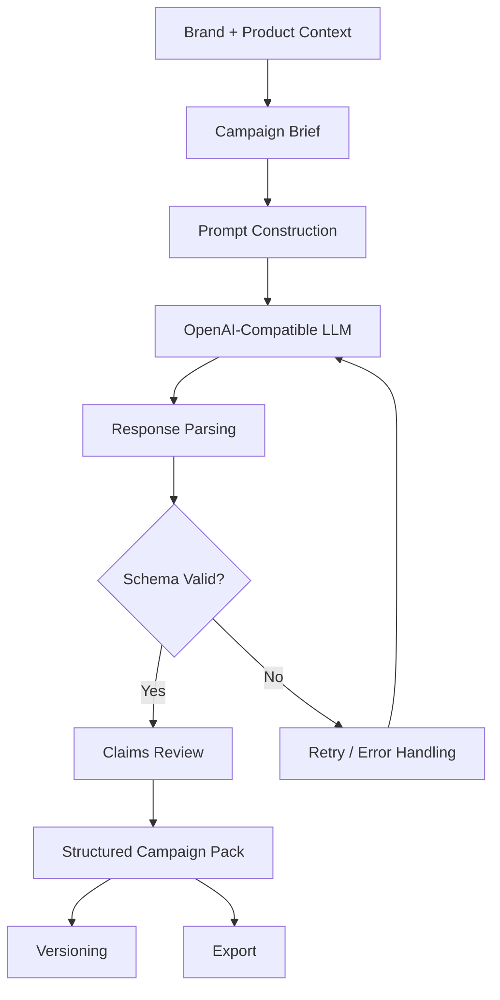
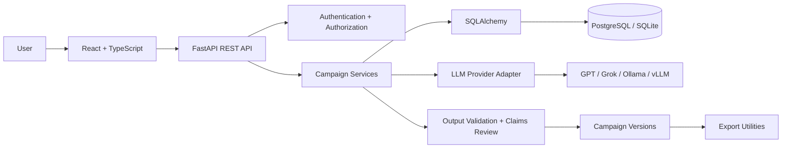

# AdCraft AI — Prompt Engineering & UGC Campaign Studio

<p align="center">
  <strong>Turn product briefs into structured, reviewable, platform-ready UGC advertising campaigns.</strong>
</p>

<p align="center">
  An AI-powered campaign generation platform built around structured prompting, schema-validated LLM outputs, claims review, and version-controlled creative workflows.
</p>

<p align="center">
  
  
  
  
  
</p>

<p align="center">
  <a href="#-quick-start">Quick Start</a> ·
  <a href="#-interactive-project-tour">Project Tour</a> ·
  <a href="#-prompt-engineering-lab">Prompt Lab</a> ·
  <a href="#-architecture">Architecture</a> ·
  <a href="#-testing-and-verification">Testing</a>
</p>

---

## 📌 Project at a Glance

| Area | Description |
|---|---|
| Problem | Creating consistent, platform-specific UGC ad campaigns requires repetitive creative work and manual review. |
| Solution | Generate structured campaign packs from brand and product information using configurable LLM providers. |
| AI focus | Prompt engineering, structured generation, output validation, retries, claims review, and provider abstraction. |
| Full-stack focus | React, TypeScript, FastAPI, SQLAlchemy 2, Alembic, PostgreSQL, and Docker Compose. |
| Primary users | Brands, marketers, creative strategists, and campaign teams. |
| Output | Hooks, scene-by-scene scripts, captions, CTAs, hashtags, platform adaptations, and claims-review results. |

> **Project status:** This repository includes implementation work that has not yet been fully verified. Passing syntax checks and dependency-free tests does not establish that the complete application runs successfully. See [Verification Status](#-testing-and-verification).

## ✨ Why This Project?

Traditional campaign production often involves manually converting a product brief into multiple creative variations, rewriting content for different platforms, checking claims, and maintaining revisions.

AdCraft AI approaches this as a structured generation pipeline rather than a single chatbot prompt.

- **Structured prompting:** Convert a campaign brief into explicit instructions and a defined output contract.
- **Controlled generation:** Request predictable fields instead of relying on unrestricted prose.
- **Validation and retries:** Reject malformed outputs and retry recoverable generation failures.
- **Claims review:** Flag potentially unsupported advertising claims for human review.
- **Provider flexibility:** Configure an OpenAI-compatible endpoint instead of hard-coding one model vendor.
- **Version control:** Preserve campaign generations and support restoration of earlier versions.
- **Exportable deliverables:** Produce campaign packs in supported formats for downstream editing and sharing.

---

## 🧭 Interactive Project Tour

<details>
<summary><strong>01 · Brand and Product Intelligence</strong></summary>

Start by registering an account and creating a brand and product.

The campaign workflow uses this information to establish the creative context, including the product description, audience, positioning, and supplied product claims.

**Why it matters:** A reusable brand and product context reduces repetitive input and provides a consistent foundation for campaign prompts.

</details>

<details>
<summary><strong>02 · Campaign Brief</strong></summary>

Create a campaign with the relevant creative requirements, such as:

- Campaign objective
- Target audience
- Preferred platform
- Tone of voice
- Creative direction
- Product-specific constraints

Only collect fields supported by the application's actual schemas and UI. The list above describes the intended campaign workflow.

</details>

<details>
<summary><strong>03 · AI Campaign Generation</strong></summary>

Click **Generate** to initiate the generation workflow.

The intended pipeline combines campaign context, prompt construction, LLM invocation, output parsing, and server-side validation.

A successful result is a structured campaign pack rather than an arbitrary block of generated text.

</details>

<details>
<summary><strong>04 · Review and Edit</strong></summary>

Review the generated creative content and its claims-review results.

Human review remains important: generated advertising copy can be inaccurate, misleading, or inconsistent with the evidence supplied by a brand.

Claims-review output is an aid to review, not legal approval or a guarantee of regulatory compliance.

</details>

<details>
<summary><strong>05 · Versions and Export</strong></summary>

Campaign generations are designed to support version history and restoration.

The export layer supports TXT, Markdown, JSON, and PDF rendering according to the implemented export utilities. Export API behavior and authorization still require full-suite verification.

**Outcome:** A campaign deliverable that can be reviewed, revised, restored, and exported.

</details>

---

## 🧠 Prompt Engineering Lab

This project treats prompting as an engineering discipline: the prompt defines the task, the input context, the constraints, and the expected output structure.

### The generation pipeline



### Anatomy of a production-oriented prompt

The following is an **illustrative prompt template**, not a claim that these exact instructions are present in the current source code.

<details>
<summary><strong>View the system prompt blueprint</strong></summary>

```text
ROLE
You are a UGC advertising creative strategist.

OBJECTIVE
Generate a campaign pack using the supplied brand,
product, audience, and campaign requirements.

SOURCE OF TRUTH
Use only the provided product information for
product-specific factual claims.

CREATIVE REQUIREMENTS
- Generate distinct opening hooks.
- Write a scene-by-scene short-form video script.
- Include captions, a call to action, and hashtags.
- Adapt creative content to the requested platform.
- Keep the tone consistent with the brand brief.

CLAIMS POLICY
- Do not invent product benefits, statistics,
  certifications, testimonials, or guarantees.
- Flag claims that lack adequate supporting evidence.
- Distinguish supplied facts from creative suggestions.
- Do not present an automated review as legal approval.

OUTPUT CONTRACT
Return the requested structured fields.
Do not include explanatory prose outside the output.
Follow the application's required schema.

VALIDATION
The server validates the returned structure.
Invalid responses may trigger a bounded retry.
```

</details>

### Prompt engineering techniques

| Technique | Purpose | Application |
|---|---|---|
| Role prompting | Establish the task perspective | UGC creative strategist |
| Context grounding | Reduce unsupported assumptions | Brand and product information |
| Constraint prompting | Define allowed and disallowed content | Claims and tone requirements |
| Structured output | Make results usable by software | Schema-constrained campaign fields |
| Validation feedback | Detect malformed generations | Parsing and server-side validation |
| Retry strategy | Recover from eligible failures | Reattempt generation within configured limits |
| Provider abstraction | Decouple prompts from one vendor | Configurable OpenAI-compatible API |

### What makes this more than a prompt wrapper?

The engineering challenge is not simply asking an LLM to write an advertisement. It is making the result usable by a full-stack application.

A reliable implementation needs to address:

1. **Input quality:** Campaign prompts must use the correct brand, product, and user-owned campaign data.
2. **Output contracts:** The backend must reject or handle invalid structured responses.
3. **Failure handling:** Provider errors and malformed responses must not silently become fabricated success responses.
4. **Claims review:** Potentially unsupported assertions should be surfaced for human verification.
5. **Persistence:** Campaign versions and edits must have clear, predictable semantics.
6. **Authorization:** Users must not access another user's brands, campaigns, versions, or exports.

---

## 📦 What Does a Campaign Pack Contain?

A campaign pack is intended to bring multiple creative assets together in a single structured deliverable.

<details>
<summary><strong>🎣 Hooks</strong></summary>

Opening lines designed to capture attention and introduce the product or problem.

Example: “Still spending your mornings looking for the one thing you need?”

This is illustrative copy, not a verified product claim.

</details>

<details>
<summary><strong>🎬 Scene-by-Scene Script</strong></summary>

A structured sequence of scenes, with relevant dialogue or voiceover, visual direction, and timing where supported by the output schema.

</details>

<details>
<summary><strong>✍️ Captions and CTAs</strong></summary>

Social copy and calls to action adapted to the campaign objective and intended audience.

</details>

<details>
<summary><strong>#️⃣ Hashtags</strong></summary>

Relevant hashtags with normalization and formatting handled by the application's helper logic where applicable.

</details>

<details>
<summary><strong>📱 Platform Adaptations</strong></summary>

Creative variations tailored to the requested platform. The actual adaptations should reflect the platform requirements supplied to the generation pipeline.

</details>

<details>
<summary><strong>🛡️ Claims Review</strong></summary>

A review of potentially unsupported product assertions, with flags that help a human reviewer determine which claims require evidence.

This is not a substitute for legal review, substantiation checks, or applicable advertising regulations.

</details>

---

## 🏗️ Architecture

### Technology stack

| Layer | Technology | Responsibility |
|---|---|---|
| Frontend | React, Vite, TypeScript | User interface and campaign workflows |
| Styling | Tailwind CSS | Responsive styling |
| API | FastAPI | HTTP endpoints and request handling |
| Data access | SQLAlchemy 2 | ORM and persistence operations |
| Migrations | Alembic | Database schema evolution |
| Database | PostgreSQL / local SQLite configuration | Persistent application data |
| AI integration | OpenAI-compatible LLM API | Text generation |
| Local inference | Ollama-compatible endpoint | Local model integration where configured |
| Deployment | Docker Compose | Container orchestration |
| Testing | pytest, Vitest, TypeScript compiler | Backend and frontend verification |

### High-level system design



### Backend organization

```text
backend/
├── app/
│   ├── api/v1/       # Versioned API routes
│   ├── core/         # Core application functionality
│   ├── models/       # ORM models
│   ├── schemas/      # Request and response schemas
│   ├── repositories/ # Data access
│   ├── services/     # Application business logic
│   ├── ai/           # LLM integration and generation
│   ├── exports/      # Export rendering
│   └── config/       # Configuration
├── alembic/          # Database migrations
└── tests/            # Backend tests

frontend/
└── src/
    ├── components/
    ├── pages/
    ├── layouts/
    ├── hooks/
    ├── services/
    ├── context/
    ├── utils/
    └── tests/

docs/
├── architecture.md
├── database-schema.md
├── api-documentation.md
├── security.md
└── deployment.md
```

Paths and documentation filenames should be checked against the current repository before publication.

---

## 🚀 Quick Start

### Prerequisites

- Docker and Docker Compose for the containerized setup
- Alternatively, Python 3.12 and Node.js 20 or compatible versions for local development
- An LLM API key for real generation, or the development-only mock provider

### Option A — Docker Compose

**1. Clone the repository**

```bash
git clone https://github.com/shriguru04/FUTURE_PE_02.git
cd FUTURE_PE_02
```

**2. Create your environment file**

```bash
cp .env.example .env
```

Configure the environment variables in `.env`. Set a strong database password, a secure secret key, and the required LLM settings.

Do not commit `.env` or expose API keys in screenshots, source code, or logs.

**3. Build and start the services**

```bash
docker compose up --build
```

**4. Open the application**

| Service | Address |
|---|---|
| Frontend / application entry point | http://localhost:8080 |
| Backend OpenAPI docs when the backend runs directly | http://localhost:8000/docs |

The exact Docker routing and documentation path depend on the current Compose configuration.

**5. Try the workflow**

1. Register an account.
2. Create a brand.
3. Add a product.
4. Create a campaign.
5. Click **Generate**.
6. Review the output and test versioning and exports.

### Option B — Local development

<details>
<summary><strong>Backend setup</strong></summary>

```bash
cd backend

python -m venv .venv
source .venv/bin/activate

pip install -r requirements.txt

cp ../.env.example .env
alembic upgrade head

uvicorn app.main:app --reload
```

On Windows, activate the virtual environment using:

```powershell
.venv\Scripts\Activate.ps1
```

The supplied local configuration is intended to default to SQLite:

```text
sqlite:///./adcraft.db
```

Verify the actual `.env.example` before relying on this default.

Open the API documentation at http://localhost:8000/docs.

</details>

<details>
<summary><strong>Frontend setup</strong></summary>

Open a second terminal:

```bash
cd frontend
npm install
npm run dev
```

Vite normally serves the frontend at http://localhost:5173. The configured development proxy should route `/api` requests to the backend on port 8000.

</details>

---

## 🔌 Configure Your LLM Provider

The application is designed to support OpenAI-compatible chat completion endpoints.

| Provider | `LLM_BASE_URL` | `LLM_MODEL` |
|---|---|---|
| OpenAI | `https://api.openai.com/v1` | A currently supported model, e.g. `gpt-4o-mini` |
| xAI | `https://api.x.ai/v1` | A currently supported Grok model |
| Ollama | `http://host.docker.internal:11434/v1` | A compatible model available locally |
| vLLM | Your configured server URL ending in `/v1` | A model served by your vLLM instance |

Example configuration:

```dotenv
LLM_PROVIDER=openai
LLM_BASE_URL=https://api.openai.com/v1
LLM_MODEL=gpt-4o-mini
LLM_API_KEY=your_api_key_here
```

Variable names and provider-specific requirements must match the application's actual configuration implementation.

**Important:** `host.docker.internal` is useful for reaching a host machine from Docker Desktop on supported platforms. Native Linux Docker setups may need additional host networking configuration. Local model availability, API compatibility, context limits, and output quality depend on the model and serving configuration.

### No API key?

For local development, the mock provider can be enabled if supported by the current configuration:

```dotenv
LLM_PROVIDER=mock
```

The intended behavior is to label mock-generated content clearly and refuse mock generation in production. Mock output is for testing the workflow only; it is not evidence of real LLM integration.

When no provider is configured, the intended behavior is to return a clear setup error rather than fabricate successful generation.

---

## 🧪 Testing and Verification

**Do not treat the repository as release-verified until these checks have actually passed.**

### Backend tests

```bash
cd backend
pytest -q
```

For PostgreSQL testing, configure a test database and run:

```bash
TEST_DATABASE_URL=postgresql+psycopg://adcraft:pw@localhost:5432/adcraft_test pytest -q
```

Use a disposable test database and suitable local credentials.

### Frontend tests

```bash
cd frontend

npm test
npm run typecheck
npm run build
```

### Docker validation

From the repository root:

```bash
docker compose config
docker compose up --build
```

Check the application, API, database connectivity, migrations, and real generation with a configured provider.

### Verification status

The repository's supplied verification notes report:

| Check | Reported status |
|---|---|
| Python syntax compilation | Passed in the authoring sandbox |
| Dependency-free pure logic tests | 9 passed using a stand-in runner |
| Full backend pytest suite | Not executed |
| FastAPI application integration | Not executed |
| Alembic migration against a database | Not executed |
| Frontend typecheck and build | Not executed |
| Frontend Vitest suite | Not executed |
| Docker build and Compose startup | Not executed |
| Real LLM generation | Not executed |
| Browser-level end-to-end tests | Not included |

These are the repository's stated results, not independently reproduced results.

### What the broader test suite is intended to cover

- Registration, login, and authentication failures
- Cross-user authorization and data isolation
- Brand, product, and campaign CRUD
- Request validation
- Malformed LLM output and retries
- Provider failure handling
- Campaign versioning and restoration
- Export formats and authorization
- Analytics calculations and zero denominators
- Database constraints and ORM/migration consistency
- An API-level end-to-end workflow

---

## 🔐 Security and Reliability

AI-generated advertising content should be treated as untrusted until reviewed.

The implementation and release process should pay particular attention to:

- **Authentication:** Validate identities and protect private endpoints.
- **Authorization:** Enforce ownership checks on every relevant resource and export.
- **Secret management:** Keep credentials out of source control and client-side bundles.
- **Input handling:** Validate campaign requests and sanitize content where required.
- **Output validation:** Parse and validate generated content before saving or exporting it.
- **Failure handling:** Surface provider errors clearly and bound retry behavior.
- **Claims review:** Flag unsupported claims without presenting automated output as legal certification.
- **Rate limiting:** Recognize that in-memory rate limits do not provide shared enforcement across multiple workers or replicas.
- **Production readiness:** Add operational monitoring, appropriate database deployment practices, and robust credential recovery before production use.

### Known limitations

The current project description identifies the following limitations:

- Manual analytics; no platform integrations or CSV import.
- Synchronous generation.
- In-memory rate limiting.
- No refresh tokens or password-reset flow.
- Latin-only PDF text rendering.
- No included Playwright/Cypress browser E2E suite.
- Full test-suite, Docker, and real-provider verification still outstanding.

Refer to the repository's security and deployment documentation for implementation-specific details.

---

## 🗺️ Suggested Engineering Roadmap

The following are potential improvements, not claims about existing functionality.

- [ ] Run and fix the complete backend test suite.
- [ ] Validate migrations and database constraints against PostgreSQL.
- [ ] Run frontend typechecking, unit tests, and a production build.
- [ ] Verify Docker Compose startup from a clean environment.
- [ ] Add browser-based end-to-end tests.
- [ ] Add prompt regression tests using a fixed set of campaign briefs.
- [ ] Measure schema-valid output rate, retry rate, latency, and token usage.
- [ ] Introduce evidence-linked claims review and human approval workflows.
- [ ] Add resilient background jobs for long-running generation.
- [ ] Add platform integrations and analytics imports.
- [ ] Add operational monitoring and production-grade rate limiting.

### Measuring prompt quality

A useful next step is to evaluate more than whether the LLM returns text.

| Metric | What it measures |
|---|---|
| Schema-valid output rate | Percentage of generations that satisfy the output contract |
| Retry rate | How often invalid output requires another attempt |
| Unsupported-claim rate | Frequency of claims that lack adequate evidence |
| Human edit rate | How much generated content requires correction |
| Generation latency | Time required to produce a campaign pack |
| Cost per pack | Approximate model usage cost per campaign generation |

These metrics should be measured from real test runs rather than reported as assumed results.

---

## 💡 What This Project Demonstrates

**AI engineering**
- Integrating configurable LLM providers
- Constructing structured prompts
- Handling malformed model responses
- Validating structured output
- Designing retry and provider-error paths

**Backend engineering**
- FastAPI API design
- SQLAlchemy ORM and database migrations
- Authentication and resource authorization
- Versioned campaign workflows
- Export rendering and API testing

**Frontend engineering**
- React with TypeScript
- Form validation and API integration
- Campaign editing workflows
- Testable utility functions

**Production-minded engineering**
- Explicit development-versus-production behavior
- Honest verification reporting
- Database consistency checks
- Security and reliability considerations

---

## 📚 Documentation

Explore the repository's documentation for implementation-specific information:

- [Repository](https://github.com/shriguru04/FUTURE_PE_02)
- [Verification Status](https://github.com/shriguru04/FUTURE_PE_02#verification-status)
- [Security Documentation](https://github.com/shriguru04/FUTURE_PE_02/blob/main/docs/security.md)
- [Deployment Documentation](https://github.com/shriguru04/FUTURE_PE_02/blob/main/docs/deployment.md)

Confirm that each linked path exists in the current branch before publishing the README.

---

## 🤝 Contributing

Contributions that improve reliability, prompt quality, test coverage, and maintainability are welcome.

1. Fork the repository.
2. Create a focused feature branch.
3. Add or update relevant tests.
4. Run the available backend and frontend checks.
5. Submit a pull request explaining the change and its verification status.

## 📄 License

Add the project's actual license here. Do not claim an open-source license unless the repository includes the corresponding license terms.

---

<p align="center">
  <strong>AdCraft AI</strong><br />
  Structured prompts. Reliable generation. Reviewable creative workflows.
</p>

<p align="center">
  Built to explore the engineering behind production-oriented LLM applications.
</p>
